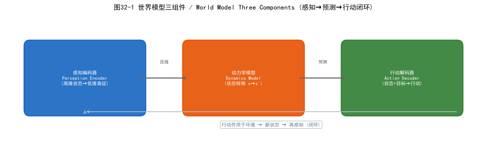
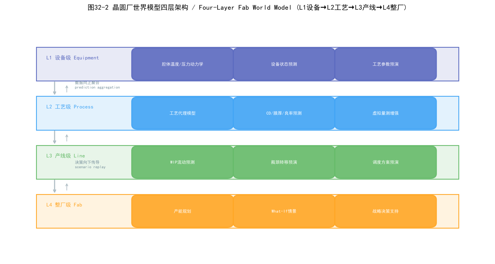
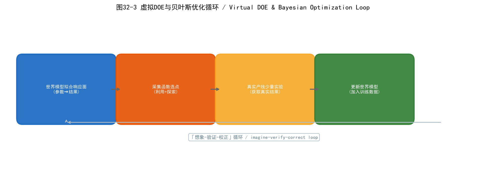
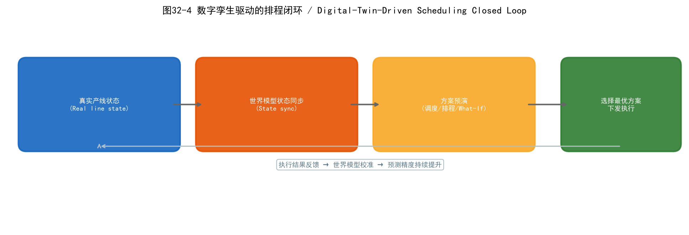
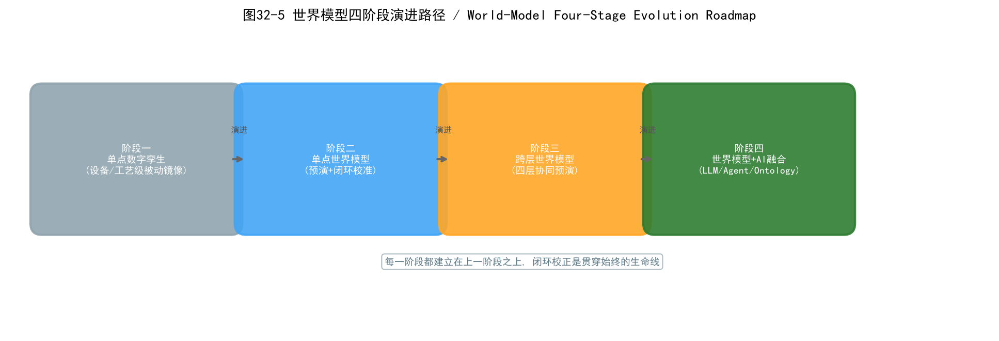

# Chapter 32: World Models in the Wafer Fab — Letting AI "Rehearse" the Fab in Its Head

> The previous chapters discussed how AI perceives (Connectionism), reasons (Symbolism), decides (Behaviorism), how LLMs/Agents collaborate, and how the data architecture supports it all. This chapter focuses on an advanced topic that packages these capabilities into a "rehearsable environment": the **World Model**.

World models have already appeared as key concepts in earlier chapters: Chapter 21 (NSA Full Fusion) defined them as "an internal model capable of simulating environmental dynamics, allowing AI to rehearse the consequences of actions in its head," and Chapter 26 (Embodied AI) listed them as the "world-model layer" of the agent technology stack. This chapter treats world models not as an accessory of some architecture, but answers three questions head-on: **what exactly is a world model, what does a fab's world model look like, and what value can it bring to fabs.**

For fabs, the significance of world models can be summarized in one sentence: **let AI rehearse manufacturing in a virtual world before "manufacturing" happens.** Yield ramp need not burn expensive experimental wafers, scheduling plans need not be tried on the real line, and equipment maintenance need not wait for failure — the world model provides the capability of "low-cost rehearsal." This is exactly the critical leap from "assisted analysis" to "assisted decision-making" on top of the data architecture of Chapter 28 and the AI infrastructure of Chapters 29–31.

This chapter has seven sections: 32.1 clarifies the relationship between digital twins and world models; 32.2 gives the four-layer architecture of a fab world model; 32.3 introduces three key modeling technologies (physics-based, data-driven, hybrid); 32.4–32.6 discuss world-model applications in yield and process optimization, manufacturing operations, and equipment & energy management respectively; 32.7 confronts the challenges and outlook.

---

## 32.1 From Digital Twins to World Models: The "Rehearsal Capability" of Fab AI

> **Core question of this section**: What is the relationship between digital twins and world models? Why do fabs need world models, not just digital twins?

### 32.1.1 Digital Twins: The Already-Widely-Accepted "Mirror"

Digital twins are no longer a new concept in fabs — Chapters 6, 7, and 8 all mention line simulation and equipment twins. The core idea: build a **virtual mirror synchronized with the real physical system** (a tool, a line, a fab); the mirror reflects the physical system's state in real time and supports simulation on top of it.

Typical forms of fab digital twins include:

- **Equipment-level twins**: a virtual model of a specific etcher, synchronizing chamber temperature, pressure, RF power, and other states in real time for equipment monitoring and fault diagnosis
- **Process-level twins**: a process-simulation model of a module (lithography, etch, thin film), simulating process outcomes under different parameters
- **Line-level twins**: a discrete-event simulation (DES) model of the entire line, simulating WIP flow, tool scheduling, and bottleneck formation

The value of digital twins is validated: they provide "simulation without touching the real line." But traditional digital twins have a key limitation — **they are mostly "passive mirror + manually driven simulation"**: models are hand-built by engineers and run for preset scenarios, lacking the ability to learn autonomously and self-evolve.

### 32.1.2 World Models: From "Mirror" to "A Brain That Rehearses"

A world model is the "intelligent upgrade" of a digital twin. The difference can be explained with an analogy: **the digital twin is a "map," the world model is a "driver who plans routes by himself."**

- **The digital twin answers**: "If I set the parameter to this value, what is the simulation result?" — a human must first pose the question and design the scenario
- **The world model answers**: "Given the current state, what should I do to make the outcome optimal?" — the model itself perceives the state, predicts the future, and evaluates action consequences

Technically, the core difference is that a world model typically contains three learnable components (echoing Chapter 21):

```
World Model = Perception Encoder (compress high-dimensional states into low-dimensional representations)
            + Dynamics Model (predict the next state: state-transition function)
            + Action Decoder (output actions based on state prediction and goals)
```



*Figure 32-1: World-model three components — perception encoder + dynamics model + action decoder, with action feedback forming the closed loop*

More critically, the world model possesses the capability of **imagination-based training**

: agents learn not only in the real environment (or on real data), but can also "imagine" a large number of unobserved scenarios inside the world model for pre-training — this is precisely the antidote to the sample-inefficiency problem of reinforcement learning in Chapter 16, and the technical basis of "rehearsing in the head" in Chapter 21's NSA full fusion.

### 32.1.3 Why Fabs Especially Need World Models

Fabs have three characteristics that make world models far more valuable than in general industrial scenarios:

**Extremely high trial-and-error cost.** A 12-inch wafer costs more than $4,000; a single process experiment burns dozens of wafers; one wrong dispatch decision can scrap an entire lot. Any technology that allows "rehearsal before acting" directly translates into cost savings.

**Highly coupled systems.** More than 1,500 process steps are interlocked; a parameter shift in one module can propagate across modules (etch loading effects affect subsequent CMP). World models can capture this cross-module, cross-tool dynamic coupling, which single-point simulation cannot.

**Huge and dynamic state space.** Tens of thousands of tools, hundreds of thousands of in-process lots, and a WIP distribution changing every minute — the fab is a continuously evolving dynamic system. Static digital-twin mirrors cannot cope; what is needed is a world model that continuously learns and self-updates with real data.

> **Practical tip:** Do not rush into a "fab-wide world model." The pragmatic path is to start at the **equipment or process level** — a chamber's temperature-pressure dynamics model, a process module's yield-response model — validate the "rehearse → optimize → verify" closed loop at a single point, then expand. Fab-wide world models involve state coupling and computational cost far beyond single-point scenarios.

> **Section summary:**
> - A digital twin is a "passive mirror + manually driven simulation"; a world model is a learnable model that "actively perceives, predicts, and decides."
> - The world model's three-component formula (perception encoder + dynamics model + action decoder) is consistent with Chapter 21's NSA full fusion.
> - World models possess "imagination-based training" capability, key to alleviating reinforcement-learning sample inefficiency.
> - The high trial-and-error cost, strong system coupling, and huge state space make world models especially valuable in fabs, but start from equipment/process-level single points.

---

## 32.2 The Four-Layer Architecture of a Fab World Model

> **Core question of this section**: At which layer should a fab world model be built? How do the layers collaborate?

### 32.2.1 From Equipment to Fab: Four Layers of World Models

Following the layered practice of digital twins, a fab world model can be divided into four levels, each solving problems at a different granularity:

| Level | Modeling object | Time scale | Typical use | Representative technology |
| --- | --- | --- | --- | --- |
| L1 Equipment | physical process of a single chamber/tool | ms~s | process-parameter rehearsal, early fault warning | mechanism models, time-series prediction |
| L2 Process | a process module (litho/etch/thin-film) | s~min | process-window optimization, virtual metrology | surrogate models, DOE |
| L3 Line | a production line (multi-tool multi-product) | min~h | WIP-flow prediction, scheduling rehearsal | discrete-event simulation, GNN |
| L4 Fab | the entire fab (multi-line + resources) | h~day | capacity planning, What-If scenarios | system dynamics, multi-agent simulation |



*Figure 32-2: Four-layer fab world model — data aggregates upward, decisions propagate downward*

**Architecture diagram (text description)**: four layers from bottom to top. L1 Equipment sits at the bottom

, taking tool sensor streams (FDC data) as input and outputting equipment-state prediction and parameter rehearsal; L2 Process sits above it, consuming multiple tools' L1 outputs plus metrology data, outputting process-result predictions (CD, film thickness, yield); L3 Line integrates all L2 process modules with MES data, outputting WIP-flow and bottleneck predictions; L4 Fab sits at the top, combining L3 results with ERP/capacity data to support capacity planning and strategic decisions. Data aggregates upward, decisions propagate downward: upper-layer models plan based on lower-layer predictions, and lower-layer models replay the upper layers' hypothetical scenarios.

### 32.2.2 Collaboration Modes Among the Four Layers

The four layers are not isolated; they interact through two collaboration modes:

**Bottom-up prediction aggregation.** The equipment-level model predicts "how chamber pressure will trend on this etcher over the next hour"; the process-level model uses it to predict "this lot's critical-dimension deviation"; the line-level model predicts "whether this lot will get stuck at a downstream step"; the fab-level model assesses "whether overall capacity is affected." Each layer takes the lower layer's prediction as input, progressively amplifying the business meaning of the information.

**Top-down scenario replay.** The fab-level model poses a hypothesis: "if lithography capacity is increased by 20%, how will the fab bottleneck shift?" This hypothesis is decomposed to the line level (bottleneck-tool changes), the process level (which steps become new bottlenecks), and the equipment level (corresponding tool load changes); each layer replays the hypothetical scenario and feeds the quantified impact back upward.

### 32.2.3 The "Data-Model-Closed-Loop" Three Elements of a World Model

Regardless of layer, a usable world model requires three elements:

**Data.** The fuel of the world model — FDC time series, metrology results, MES events, equipment logs. Data quality and coverage directly determine world-model accuracy (echoing the data architecture of Chapter 28).

**Model.** Physics-based, data-driven, or a hybrid of the two (see Section 32.3).

**Closed loop.** The world model's predictions must be compared, calibrated, and updated against real results — the "predict → verify → correct" loop is the lifeline of world-model accuracy. A world model without a closed loop will drift further from the line as the process drifts.

> **Practical tip:** The criterion for judging whether a world model is "alive" is not the complexity of its simulation engine, but whether it **continuously ingests real data and continuously calibrates its predictions**. Many digital-twin projects die from "built then static" — model and real line drift apart. Plan the closed-loop calibration channel from day one.

> **Section summary:**
> - A fab world model has four layers: equipment (L1), process (L2), line (L3), fab (L4), with time scales from milliseconds to days.
> - The four layers collaborate through "bottom-up prediction aggregation" and "top-down scenario replay."
> - Every layer needs the data-model-closed-loop three elements; a world model without closed-loop calibration will drift from the line.

---

## 32.3 Three Key Modeling Technologies

> **Core question of this section**: Which technologies implement the "dynamics model" of a fab world model? What scenarios suit each of the three main technical routes?

The "dynamics model" of a world model — the part that predicts how states evolve — is the technical core. In fab scenarios there are three mainstream routes, often combined in practice.

### 32.3.1 Physics-Based Mechanism Models (White-box)

State-evolution equations based on physical/chemical principles. For example:

- **Chamber thermal model**: a temperature-dynamics equation based on heat capacity, heat conduction, and heating power, predicting temperature-control response
- **Etch-rate model**: based on the Arrhenius equation and plasma parameters (pressure, RF power, gas ratio) to predict etch rate
- **CMP polishing model**: based on Preston's equation (removal rate ∝ pressure × relative velocity) to predict material removal

```python
# Example: CMP removal-rate prediction via Preston's equation
def preston_removal_rate(pressure, velocity, k_p=1.2e-3):
    """Preston's equation: RR = k_p * P * V
    pressure: polish pressure (psi), velocity: relative velocity (m/s)"""
    return k_p * pressure * velocity
```

**Advantages**: highly interpretable, good extrapolation (can predict for unseen parameter regimes based on physical laws), low data requirement. **Disadvantages**: hard to model (real processes often involve multi-physics coupling, nonlinearity, unknown mechanisms); accuracy is limited by the depth of physical understanding.

### 32.3.2 Data-Driven Models (Black-box)

Use machine learning to learn state-evolution laws from historical data. Typical forms in fab scenarios:

- **Time-series prediction models**: LSTM/Transformer predict FDC parameter trends (echoing Connectionism in Chapter 15)
- **Surrogate models**: neural networks/Gaussian processes fit the "process parameters → process results" response surface, replacing expensive physics simulation
- **GNN line models**: model tools, lots, and process steps as a graph; GNN predicts WIP flow and bottlenecks (echoing smart scheduling in Chapter 12)

```python
# Example: Gaussian process as a process surrogate (process parameters → CD)
from sklearn.gaussian_process import GaussianProcessRegressor
gp = GaussianProcessRegressor()
gp.fit(X_doe, y_cd)          # X_doe: historical DOE parameters, y_cd: corresponding CD metrology
cd_pred, cd_std = gp.predict(X_new, return_std=True)  # prediction + uncertainty
```

**Advantages**: no need to understand physics deeply; captures complex nonlinear relationships; short development cycles. **Disadvantages**: data hungry, poor interpretability, weak extrapolation (unreliable for inputs outside the training distribution), sensitive to data quality (echoing Chapter 28: label errors make models "confidently wrong").

### 32.3.3 Hybrid Modeling (Grey-box): Physics Constraints + Data Fitting

Hybrid modeling combines the advantages of both: **use physics formulas as the skeleton, and fit the uncertain parameters within them using data.** This is the most recommended route in fab scenarios.

```python
# Example: hybrid etch-rate model — Arrhenius formula as skeleton, activation energy fitted by data
# Physics skeleton: RR = A * exp(-Ea/(R*T)) * f(pressure, rf)
# Data fitting: fit A and Ea from history (they typically drift with equipment state)
def hybrid_etch_rate(temp, pressure, rf, A, Ea):
    R = 8.314
    return A * np.exp(-Ea/(R*temp)) * (1 + 0.1*pressure) * (1 + 0.05*rf)
```

**Advantages**: combines interpretability and fitting accuracy; extrapolation better than pure data models; parameter drift can be tracked via online calibration (re-fit A, Ea as equipment ages). **Disadvantages**: still requires physical understanding; fitting process is more complex.

### 32.3.4 Selection Guide for the Three Routes

| Dimension | Physics model | Data-driven model | Hybrid model |
| --- | --- | --- | --- |
| Interpretability | High | Low | Medium-high |
| Extrapolation | Good | Poor | Good |
| Data requirement | Low | High | Medium |
| Modeling difficulty | High | Low | Medium |
| Online calibration | Hard (many parameters) | Easy (retrain) | Easy (calibrate key parameters only) |
| Fab use case | equipment physics, clear mechanisms | complex response surfaces, ample data | physics prior + parameter drift (strongly recommended) |

> **Practical tip:** The most common mistake in fab world models is "fetishizing pure data-driven models" — they perform impressively within the training distribution, but once equipment maintenance or process changes shift the distribution, predictions immediately fail. For critical process models, strongly recommend **hybrid modeling**: use physics formulas to constrain behavioral boundaries and data to fit drift parameters, preserving both extrapolation and calibration.

> **Section summary:**
> - Three modeling routes: physics-based (white-box), data-driven (black-box), and hybrid (grey-box), each with pros and cons.
> - Physics models are interpretable but hard to build; data models are flexible but extrapolate poorly; hybrid models (physics skeleton + data fitting) are the most recommended in fabs.
> - Route selection must balance interpretability, extrapolation, data requirement, and online calibration.

---

## 32.4 World Models in Yield and Process Optimization

> **Core question of this section**: How do world models move yield analysis and process optimization from "burning wafers in experiments" to "virtual rehearsal"?

### 32.4.1 Virtual Yield Ramp: Rehearsing Process Development in Imagination

The yield ramp discussed in Chapter 9 is expensive because each experimental wafer costs more than $4,000, and every DOE experiment must genuinely run on the line. World models offer a "rehearse first, verify later" path:

- **Process-level world-model DOE rehearsal**: use the process surrogate model of Section 32.3 as a "virtual test bench"; run the entire DOE parameter combination (temperature, pressure, gas flow, RF power) in the model, predicting CD, film thickness, and yield for each combination — then select the most promising parameter region and verify only a few key points on the real line
- **Yield-response-surface visualization**: the surrogate model outputs the complete "process parameters → yield" response surface, letting engineers see the process-window boundary at a glance, guiding the PWI (process window index) optimization of Chapter 9
- **Cross-module coupling rehearsal**: process-level world models capture chains such as "etch loading effect → CMP dishing → poor metal fill," detecting cascading problems from single-point optimization in advance

**Case**: a fab used a Gaussian-process surrogate model to rehearse an etch DOE, compressing a window scan that originally needed 120 experimental wafers to 16 — the world model preselects the most informative parameter points, and experiments verify only the critical boundaries. The DOE cycle dropped from 4 weeks to 1 week, and found a better window that physical experiments had missed.

### 32.4.2 Virtual Metrology and Process-Control Enhancement

Virtual metrology (VM) is essentially a "process-level world model": it takes FDC sensor data as input and predicts results that would otherwise require measurement. The world-model framework extends VM's capability further:

- **Multi-step prediction**: traditional VM predicts the current lot's metrology value; a world model can predict several steps ahead — "if this tool keeps drifting, how will film thickness evolve over the next 3 lots" — providing a time window for predictive adjustment
- **Uncertainty quantification**: surrogate models (e.g., Gaussian processes) output confidence intervals alongside predictions, letting engineers distinguish "high-confidence predictions" (safe to skip inspection) from "low-confidence predictions" (must measure)
- **Linkage with R2R control**: the world model's prediction can serve as a feed-forward signal for Run-to-Run control, adjusting the next lot's process parameters in advance to compensate for tool drift (echoing the R2R control of Chapter 8)

### 32.4.3 Virtual DOE and Bayesian Optimization

The Bayesian optimization mentioned in Chapter 9 is a direct application of the world-model idea: fit the process response surface with a surrogate model, and use an acquisition function to decide the next experimental point. The world-model framework makes Bayesian optimization more systematic:

```
Iterative loop:
1. World model (surrogate) fits the currently known  parameters→results  response surface
2. Acquisition function searches the surface for the "most valuable" next experiment point
   (high predicted value → exploitation; high uncertainty → exploration)
3. Execute a few experiments on the real line, obtain real results
4. Add real results to training data, update the world model → back to 1
```



*Figure 32-3: The "imagine-verify-correct" loop of virtual DOE and Bayesian optimization*

This "imagine-verify-correct" loop is the embodiment

 of the world model's "imagination-based training" idea in experimental design. Compared with traditional DOE (preset grid, uniform points), virtual DOE finds better parameter combinations with the same experimental budget, or finds the same optimum with an order of magnitude fewer experiments.

> **Section summary:**
> - Process-level world models move yield ramp from "burning wafers in experiments" to "rehearse first, verify later"; DOE cycles can drop from 4 weeks to 1 week.
> - Virtual metrology is essentially a process-level world model; the framework adds multi-step prediction and uncertainty quantification.
> - The "imagine-verify-correct" loop of virtual DOE + Bayesian optimization is a direct application of world models in experimental design.

---

## 32.5 World Models in Manufacturing Operations

> **Core question of this section**: How do line-level and fab-level world models improve the quality of scheduling, dispatch, and capacity planning?

### 32.5.1 WIP-Flow and Bottleneck Rehearsal

The core challenge of the manufacturing division (MFG) in Chapter 7 is dynamic scheduling — the WIP distribution changes by the minute and bottlenecks shift constantly. The line-level world model (L3) provides "rehearsal capability":

- **WIP-flow prediction**: taking MES data and tool states as input, the world model predicts the WIP distribution hours ahead — which steps will backlog, which tools will idle
- **Bottleneck-shift rehearsal**: replay the scenario "if this tool is down for 2 hours" in the model, predicting where the bottleneck will shift and which lots will be affected, preparing countermeasures in advance
- **Scheduling-plan rehearsal**: feed candidate scheduling plans (dispatch rules, priority settings) into the world model, compare cycle time and bottleneck utilization across plans, and dispatch only the chosen plan to the real line

### 32.5.2 Dynamic Scheduling and What-If Scenarios

The smart scheduling of Chapter 12 discusses RL schedulers trained in simulation before deployment — the world model is the core of that "simulation environment." World models allow the RL scheduler to:

- **Trial and error massively in imagination**: the RL agent interacts with the virtual line inside the world model millions of times, learning a robust scheduling policy without touching the real line (alleviating the sample-efficiency problem raised in Chapter 16)
- **Scenario evaluation**: for scenarios such as "rush-order insertion," "tool failure," and "holiday capacity reduction," the world model replays the consequences of different response strategies, assisting management decisions
- **Capacity What-If simulation**: the fab-level world model (L4) supports virtual rehearsal of strategic scenarios such as "add tools," "adjust OEE," and "new-product introduction" (echoing the capacity ramp of Chapter 10), validating decisions in a virtual fab first

**Case**: a fab used a line-level discrete-event simulation as the training environment for its RL scheduler; after the dispatch policy was validated in simulation (about 9% output improvement, echoing the AISSI project conclusion in Chapter 12), it was deployed to the real line. The world model turned RL from "uncontrollable trial and error on the line" into "learn enough in the virtual line first, then take the job."

### 32.5.3 Digital-Twin-Driven Scheduling Closed Loop

A world model is not a one-shot simulation tool but a continuously evolving closed-loop system:

```
Real-line state → world-model state sync → plan rehearsal (scheduling/dispatch/What-If)
   ↑                                          ↓
   └── execution-result feedback ← real-line execution ← select optimal plan and dispatch
```



*Figure 32-4: Digital-twin-driven scheduling closed loop — state sync → plan rehearsal → execution → feedback calibration*

Each real execution result flows back to the world model for calibration

, and prediction accuracy keeps improving with accumulated line data. This is the embodiment of Chapter 28's "data-knowledge-decision" closed loop in manufacturing operations — the world model is the vehicle that lets "decisions" be validated virtually before executed in reality.

> **Section summary:**
> - Line-level world models provide three capabilities: WIP-flow prediction, bottleneck-shift rehearsal, and scheduling-plan rehearsal.
> - The world model is the "imagination-based training" environment for RL schedulers, letting policies learn fully in a virtual line before going on shift.
> - The digital-twin-driven scheduling closed loop — state sync → plan rehearsal → execution → feedback calibration — lets the world model evolve continuously with data.

---

## 32.6 World Models in Equipment and Energy Management

> **Core question of this section**: How do equipment-level and fab-level world models empower predictive maintenance and energy optimization?

### 32.6.1 Equipment-Degradation Rehearsal and Predictive Maintenance

Chapter 12 discusses RUL (remaining useful life) prediction for predictive maintenance. The equipment-level world model (L1) upgrades RUL prediction to "degradation-process rehearsal":

- **Degradation-trajectory prediction**: the world model learns how equipment health features degrade (vibration, temperature, pressure, RF power evolving with runtime) — predicting not only "when failure occurs" but rehearsing the complete degradation trajectory from now to failure
- **Maintenance-impact rehearsal**: replay in the model "how the degradation trajectory resets after PM" and "how much failure risk skipping PM brings," quantifying the long-term impact of maintenance decisions
- **Part-replacement rehearsal**: replay "to what level equipment performance recovers after replacing a part," evaluating replacement timing and cost-effectiveness

```python
# Example: equipment-degradation world model — rehearse failure risk under different PM strategies
def simulate_degradation(world_model, pm_schedule, horizon_days):
    """Replay different PM strategies in the equipment world model, counting failure risk"""
    state = world_model.initial_state()
    failure_risk = 0.0
    for day in range(horizon_days):
        if day in pm_schedule:      # execute PM, health state resets
            state = world_model.apply_pm(state)
        else:
            state = world_model.step(state)   # advance by degradation dynamics
            failure_risk += world_model.failure_probability(state)
    return failure_risk
```

### 32.6.2 Energy-Scheduling Rehearsal

The energy management of Chapter 12 discusses off-peak production. The fab-level world model (L4) upgrades energy optimization from "based on historical statistics" to "based on future prediction":

- **Energy-consumption prediction**: the world model predicts the energy-consumption curves of each tool and process step over the next 24 hours (combining production plans and tool states)
- **Off-peak rehearsal**: replay the plan "move some lots to low-tariff hours" in the model, evaluating the dual impact on cycle time and energy cost
- **HVAC linkage**: the cleanroom HVAC is a major energy consumer; the world model predicts the coupling of production load and external temperature/humidity, rehearsing dynamic HVAC optimization strategies

### 32.6.3 Cross-Domain Collaboration: The "Global View" of World Models

The value of world models is further amplified in cross-domain collaboration — the same world model can support four domains — equipment, process, operations, and energy — simultaneously:

- Equipment-degradation rehearsal results affect the process-level model's parameter-drift predictions
- Process-level predictions affect line-level WIP flow and scheduling
- Scheduling plans affect energy curves and energy optimization
- Energy constraints in turn constrain scheduling (low-tariff hours prioritized)

This "one world model, shared across domains, cross-layer collaboration" capability is what traditional single-point digital twins cannot provide — and it is the core value of world models as fab AI infrastructure.

> **Section summary:**
> - Equipment-level world models upgrade RUL prediction to "degradation-trajectory rehearsal," quantifying the long-term failure risk of different PM strategies.
> - Fab-level world models upgrade energy optimization from historical statistics to future prediction, supporting off-peak-plan rehearsal.
> - The cross-domain collaboration of world models — one model shared by equipment/process/operations/energy — is its core value as AI infrastructure.

---

## 32.7 Challenges and Outlook

> **Core question of this section**: What real-world challenges does the deployment of fab world models face? How will they evolve?

### 32.7.1 Accuracy and Trustworthiness Challenges

The value of a world model rests entirely on "trustworthy predictions" — if the plans it rehearses fail on the real line, engineers will no longer trust it. Three accuracy-related challenges:

- **Sim-to-Real gap**: irreducible deviation exists between simulation models and the real line (unmodeled physical effects, approximation assumptions, parameter simplifications). It must be continuously narrowed through closed-loop calibration, not one-shot modeling
- **Rare-event coverage**: world models predict "normal operating conditions" well, but predictions for rare events such as "sudden tool failure" and "process anomaly" are often distorted — and these are exactly the scenarios fabs most need to rehearse
- **Verification cost**: verifying a world model's predictions requires real data/experiments, and real experiments are precisely the cost the world model aims to save — there is an inherent tension in "using expensive real experiments to validate a money-saving model"

### 32.7.2 Data and Compute Challenges

- **Data coverage**: the world model needs to cover the full state space of the line, but real data often only covers the vicinity of "normal operating conditions" (echoing Chapter 28: anomaly-condition data is scarce). Transfer learning and physics priors are needed to fill data blind spots
- **Real-time requirements**: line-level/fab-level rehearsal needs fast response (minute-level), while high-precision simulation (CFD, FEM) is computationally expensive. Accuracy and speed must be traded off — use surrogate models to replace expensive simulation
- **Compute infrastructure**: large-scale world-model training needs GPU clusters, and real-time inference needs edge nodes — exactly the engineering problems Chapter 29's "AI computing infrastructure" solves

### 32.7.3 The Fusion Outlook with LLM/Agent/Ontology

The future of world models is not in isolation, but in fusion with the rest of this book's technical system:

- **Fusion with LLM**: the LLM can act as the world model's "natural-language interface" — an engineer asks in natural language "if lithography capacity increases 20%, how will yield change?", the LLM translates the question into a world-model query and translates the result back into a natural-language report (echoing Chapter 22 LLM applications)
- **Fusion with Agent**: planning agents in multi-agent systems (Chapter 17 SA fusion) can rehearse action consequences in the world model before executing — "try it in the world first, then act in reality" (echoing Chapter 23 Agent systems)
- **Fusion with Ontology**: the knowledge graph of Chapter 28 provides the "object-relationship" semantic skeleton for the world model, and the world model provides "dynamic evolution" for the knowledge graph — static semantics + dynamic simulation complement each other

### 32.7.4 Evolution Roadmap Outlook



*Figure 32-5: World-model four-stage evolution roadmap — from single-point digital twin to world model + AI fusion*

Following Chapter 21's "four-stage evolution," fab world-model construction can also proceed in phases

:

| Stage | Form | Capability |
| --- | --- | --- |
| Stage 1 | single-point digital twin | equipment/process-level passive mirror, manually driven simulation |
| Stage 2 | single-point world model | single-point rehearsal + closed-loop calibration (virtual DOE, VM enhancement) |
| Stage 3 | cross-layer world model | four-layer (equipment/process/line/fab) collaborative rehearsal |
| Stage 4 | world model + AI fusion | LLM/Agent/Ontology full-stack fusion — a "virtual fab" |

> **Practical tip:** World-model projects most often die at the transition from stage 1 to stage 2 — after building a single-point digital twin, no continuous closed-loop calibration is invested, and the model drifts away from the real line. The pragmatic advice: **design the "predict-verify-correct" data feedback channel at stage 1**, so the world model is "alive" from day one.

---

## Chapter Summary

World models are the key infrastructure for fab AI to move from "assisted analysis" to "assisted decision-making" — they let AI rehearse manufacturing in a virtual world before "manufacturing" happens. This chapter followed the logic of "what it is → how to build it → where to use it → what challenges" and gave a complete answer:

**What it is**: a world model is the intelligent upgrade of a digital twin — "the digital twin is a map; the world model is a driver who plans routes by himself." It consists of three components — perception encoder, dynamics model, action decoder — and possesses "imagination-based training" capability, alleviating the sample-inefficiency of reinforcement learning.

**How to build it**: a fab world model has four layers (equipment L1, process L2, line L3, fab L4), collaborating through "bottom-up prediction aggregation" and "top-down scenario replay"; the dynamics model has three technical routes (physics-based, data-driven, hybrid), of which hybrid modeling (physics skeleton + data fitting) is the most recommended in fabs; every layer needs the "data-model-closed-loop" three elements, and closed-loop calibration is the lifeline.

**Where to use it**: process-level world models move DOE from "burning wafers in experiments" to "rehearse first, verify later" (cycle from 4 weeks to 1 week); line-level world models provide the "imagination-based training" environment for RL schedulers; equipment-level and fab-level world models upgrade predictive maintenance and energy management; one world model shared across domains is its core value as AI infrastructure.

**What challenges**: sim-to-real gap, rare-event coverage, and verification cost are accuracy challenges; data coverage, real-time requirements, and compute infrastructure are engineering challenges; the future lies in fusion with LLM, Agent, and Ontology — when world models merge with the technical system built throughout this book, fabs will have a "virtual fab that can rehearse every decision."

For fabs, the ultimate vision of world models is not to replace any single AI application, but to provide all AI applications with a **low-cost "rehearsal environment" for trial and error** — yield analysis verified on virtual processes first, scheduling decisions rehearsed on virtual lines first, maintenance strategies evaluated on virtual equipment first. When this rehearsal environment is trustworthy, real-time, and intelligent enough, fab AI truly moves from "understanding the past" to "rehearsing the future."


