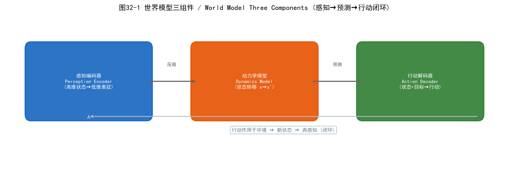
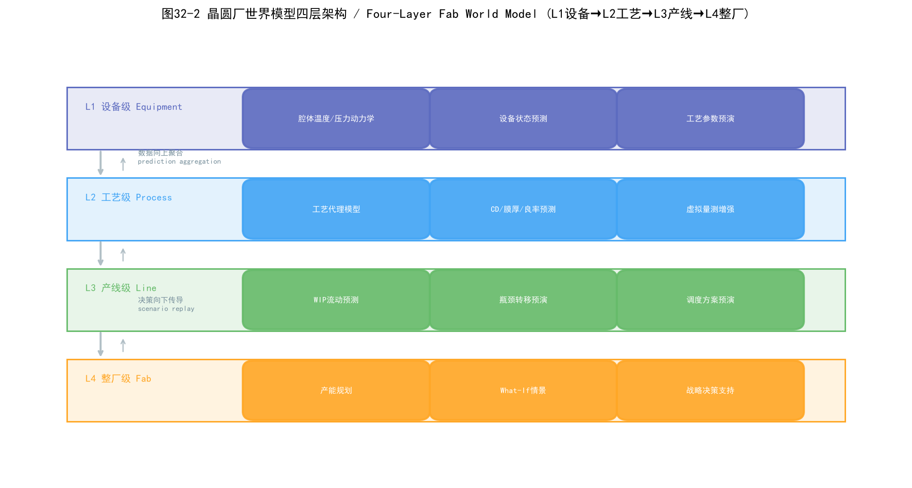
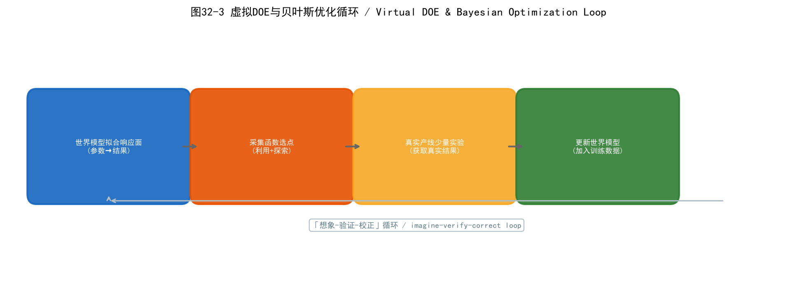
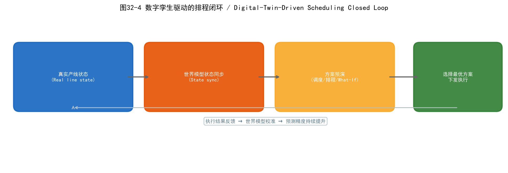
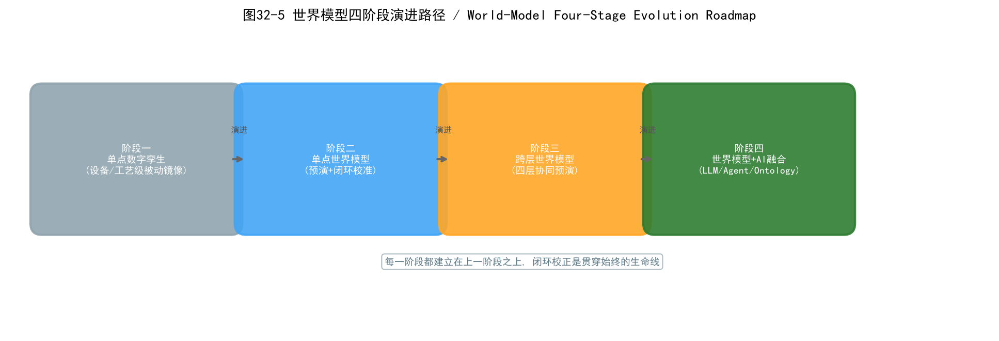

# 第32章 世界模型在晶圆厂的应用——让AI在"脑中"预演晶圆厂

> 前几章讨论了 AI 如何感知（连接主义）、如何推理（符号主义）、如何决策（行为主义），以及 LLM/Agent 如何协作、数据体系如何支撑。本章聚焦一个把这些能力"装进一个可预演环境"的进阶主题：**世界模型（World Model）**。

在前面章节中，世界模型已经作为关键概念出现：第21章（NSA全融合）把它定义为"能够模拟环境动态变化的内部模型，使AI能够在脑中预演行动的后果"，第26章（具身智能）把它列为智能体技术栈中的"世界模型层"。本章不再把它当作某个架构的附属组件，而是正面回答三个问题：**世界模型到底是什么、晶圆厂的世界模型长什么样、它能给晶圆厂带来什么价值**。

对晶圆厂而言，世界模型的意义可以用一句话概括：**让 AI 在"制造之前"先在虚拟世界里把制造预演一遍**。良率爬坡不必烧掉昂贵的实验晶圆，排程方案不必先在真实产线上试错，设备维护不必等到故障发生——世界模型提供了"低代价预演"的能力，这正是第28章数据体系与第29-31章 AI Infra 之上，AI 从"辅助分析"走向"辅助决策"的关键一跃。

本章共七节：32.1 厘清数字孪生与世界模型的关系；32.2 给出晶圆厂世界模型的四层架构；32.3 介绍三种关键建模技术（物理仿真、数据驱动、混合建模）；32.4-32.6 分别讨论世界模型在良率与工艺、制造运营、设备与能源三大业务领域的应用；32.7 直面挑战与展望。

---

## 32.1 从数字孪生到世界模型：晶圆厂AI的"预演能力"

> **本节核心问题**：数字孪生与世界模型是什么关系？为什么晶圆厂需要世界模型而不仅仅是数字孪生？

### 32.1.1 数字孪生：已经被广泛接受的"镜像"

数字孪生（Digital Twin）在晶圆厂已经不算新概念——第6、7、8章都提到了产线仿真、设备孪生等应用。它的核心思想是：为真实物理系统（一台设备、一条产线、一座工厂）建立一个**与之同步的虚拟镜像**，虚拟镜像实时反映物理系统的状态，并可以在此基础上进行仿真推演。

晶圆厂数字孪生的典型形态包括：

- **设备级孪生**：为某台刻蚀机建立虚拟模型，实时同步腔体温度、压力、RF功率等状态，用于设备监控与故障诊断
- **工艺级孪生**：为某个工艺模块（光刻、刻蚀、薄膜）建立工艺仿真模型，模拟不同参数下的工艺结果
- **产线级孪生**：为整条产线建立离散事件仿真（DES, Discrete Event Simulation）模型，模拟 WIP 流动、设备调度与瓶颈形成

数字孪生的价值已被验证：它提供了"在不触碰真实产线的前提下进行仿真"的能力。但传统数字孪生有一个关键局限——**它主要是"被动镜像 + 人工驱动仿真"**：模型由工程师手工构建、按预设场景推演，缺乏自主学习、自我演化的能力。

### 32.1.2 世界模型：从"镜像"到"会预演的大脑"

世界模型（World Model）是数字孪生的"智能升级"。两者的区别可以用一个类比说明：**数字孪生是"地图"，世界模型是"会自己规划路线的驾驶员"**。

- **数字孪生回答**："如果我把参数调到这个值，仿真的结果是什么？"——需要人先提出问题、设计场景
- **世界模型回答**："在给定当前状态下，我应该做什么，才能让结果最优？"——模型自己感知状态、预测未来、评估行动后果

技术上的核心差异在于，世界模型通常包含三个可学习的组件（呼应第21章的表述）：

```
世界模型 = 感知编码器（将高维状态压缩为低维表征）
         + 动力学模型（预测下一时刻状态：状态转移函数）
         + 行动解码器（基于状态预测与目标，输出行动）
```



*图32-1:世界模型三组件——感知编码器+动力学模型+行动解码器,行动反馈形成闭环*

更关键的是，世界模型具备**"在想象中训练"（imagination-based training）**的能力

：Agent 不只在真实环境（或真实数据）中学习，还可以在世界模型内部"想象"大量未发生的场景进行预训练——这正是第16章强化学习样本效率低问题的解药，也是第21章 NSA 全融合中"在脑中预演"的技术基础。

### 32.1.3 为什么晶圆厂特别需要世界模型

晶圆厂有三个特性，使世界模型的价值远高于一般工业场景：

**试错成本极高。** 一片12英寸晶圆成本超过4000美元，一次工艺实验要烧掉数十片；一次错误的设备调度可能导致整批晶圆报废。任何能在"动手之前先预演"的技术都直接转化为成本节省。

**系统高度耦合。** 1500多道工艺步骤环环相扣，一个参数偏移可能跨模块传导（刻蚀的负载效应影响后续CMP）。世界模型可以捕捉这种跨模块、跨设备的动态耦合，而传统单点仿真做不到。

**状态空间巨大且动态。** 数万台设备、数十万个在制批次、每分钟都在变化的 WIP 分布——晶圆厂是一个持续演化的动态系统。静态的数字孪生镜像难以应对，需要一个能持续学习、随真实数据自我更新的世界模型。

> **实践提示:** 不要一上来就追求"整厂级世界模型"。务实的路径是从**设备级或工艺级**起步——一个腔体的温压动力学模型、一个工艺模块的良率响应模型——先在单点上验证"预演→优化→验证"闭环的价值，再逐步扩展。整厂级世界模型涉及的状态耦合与计算成本，远超单点场景。

> **本节小结:**
> - 数字孪生是"被动镜像 + 人工驱动仿真"，世界模型是"主动感知 + 预测 + 决策"的可学习模型。
> - 世界模型的三组件公式（感知编码器 + 动力学模型 + 行动解码器）与第21章 NSA 全融合一脉相承。
> - 世界模型具备"在想象中训练"的能力，是缓解强化学习样本效率低的关键。
> - 晶圆厂的高试错成本、系统强耦合、状态空间巨大三个特性，使世界模型价值突出，但应从设备/工艺级单点起步。

---

## 32.2 晶圆厂世界模型的四层架构

> **本节核心问题**：晶圆厂的世界模型应该建在哪一层？各层之间如何协作？

### 32.2.1 从设备到整厂：四层世界模型

参照数字孪生的分层实践，晶圆厂世界模型可以划分为四个层次，每层解决不同粒度的问题：

| 层级 | 建模对象 | 时间尺度 | 典型用途 | 代表技术 |
| --- | --- | --- | --- | --- |
| L1 设备级 | 单个腔体/机台的物理过程 | 毫秒~秒 | 工艺参数预演、故障早期预警 | 机理模型、时序预测 |
| L2 工艺级 | 一个工艺模块（光刻/刻蚀/薄膜） | 秒~分钟 | 工艺窗口优化、虚拟量测 | 代理模型（Surrogate）、DOE |
| L3 产线级 | 一条产线（多设备多产品） | 分钟~小时 | WIP 流动预测、调度预演 | 离散事件仿真、图神经网络 |
| L4 整厂级 | 整座工厂（多产线+资源） | 小时~天 | 产能规划、What-If 情景 | 系统动力学、多智能体仿真 |



*图32-2:晶圆厂世界模型四层架构——数据向上聚合,决策向下传导*

**架构图（文字描述）**：自下而上四层。L1 设备级位于底层

，输入为设备传感器流（FDC 数据），输出为设备状态预测与参数预演；L2 工艺级在其上，消费多个设备的 L1 输出与量测数据，输出工艺结果（CD、膜厚、良率）预测；L3 产线级整合所有 L2 工艺模块与 MES 数据，输出 WIP 流动与瓶颈预测；L4 整厂级位于最顶层，综合 L3 结果与 ERP/产能数据，支持产能规划与战略决策。数据向上聚合，决策向下传导：上层模型基于下层模型的预测做规划，下层模型响应上层的假设情景进行重放。

### 32.2.2 四层之间的协作模式

四层世界模型不是各自孤立的，它们通过两种协作模式联动：

**自底向上的预测聚合。** 设备级模型预测"这台刻蚀机未来1小时的腔体压力走势"，工艺级模型据此预测"这批晶圆的关键尺寸偏差"，产线级模型据此预测"这批晶圆会不会在下游步骤卡住"，整厂级模型据此评估"整体产能是否受影响"。每层把下层的预测作为输入，逐层放大信息的业务含义。

**自顶向下的情景重放。** 整厂级模型提出假设："如果把光刻产能提升20%，整厂瓶颈会如何转移？" 这个假设被分解到产线级（瓶颈设备变化）、工艺级（哪些工艺步骤成为新瓶颈）、设备级（对应设备的负载变化），各层模型重放假设情景，把影响逐层量化后反馈给上层。

### 32.2.3 世界模型的"数据-模型-闭环"三要素

无论哪一层，一个可用的世界模型都需要三个要素：

**数据。** 世界模型的燃料——FDC 时序、量测结果、MES 事件、设备日志。数据的质量与覆盖度直接决定世界模型的精度（呼应第28章数据体系）。

**模型。** 物理机理模型、数据驱动模型或两者的混合（详见32.3节）。

**闭环。** 世界模型的预测必须与真实结果对比、校准、更新——"预测→验证→校正"的闭环是世界模型保持准确性的生命线。没有闭环的世界模型会随着产线漂移而逐渐失真。

> **实践提示:** 判断一个世界模型是否"活"的标准，不是它的仿真引擎有多复杂，而是它**是否在持续吃进真实数据、持续校准自己的预测**。很多数字孪生项目死于"建完就静态了"——模型和真实产线渐行渐远。务必从设计之初就规划好闭环校准通道。

> **本节小结:**
> - 晶圆厂世界模型分四层：设备级(L1)、工艺级(L2)、产线级(L3)、整厂级(L4)，时间尺度从毫秒到天。
> - 四层通过"自底向上的预测聚合"与"自顶向下的情景重放"两种模式协作。
> - 每层世界模型都包含数据、模型、闭环三要素；没有闭环校准的世界模型会随产线漂移失真。

---

## 32.3 三种关键建模技术

> **本节核心问题**：晶圆厂世界模型的"动力学模型"用技术实现？三种主流技术路线各有什么适用场景？

世界模型的"动力学模型"——即预测状态如何演化的那部分——是技术核心。晶圆厂场景下有三种主流路线，实际项目中常组合使用。

### 32.3.1 物理机理模型（White-box）

基于物理/化学原理建立的状态演化方程。例如：

- **腔体热模型**：根据热容、热传导、加热功率建立温度动态方程，预测温控响应
- **刻蚀速率模型**：基于 Arrhenius 方程与等离子体参数（压力、RF功率、气体比例）预测刻蚀速率
- **CMP 抛光模型**：基于 Preston 方程（去除率 ∝ 压力 × 相对速度）预测材料去除量

```python
# 示例: 基于 Preston 方程的 CMP 去除率预测
def preston_removal_rate(pressure, velocity, k_p=1.2e-3):
    """Preston 方程: RR = k_p * P * V
    pressure: 抛光压力 (psi), velocity: 相对速度 (m/s)"""
    return k_p * pressure * velocity
```

**优点**：可解释性强、外推能力好（参数没见过的场景也能依据物理规律预测）、数据需求少。**缺点**：建模难度大（真实工艺常有多物理场耦合、非线性、未知机理），模型精度受制于对物理机理的理解深度。

### 32.3.2 数据驱动模型（Black-box）

用机器学习从历史数据中学习状态演化规律。晶圆厂场景下的典型形态：

- **时序预测模型**：LSTM/Transformer 预测 FDC 参数趋势（呼应第15章连接主义）
- **代理模型（Surrogate Model）**：用神经网络/高斯过程拟合"工艺参数→工艺结果"的响应面，替代昂贵的物理仿真
- **图神经网络产线模型**：把设备、批次、工艺步骤建模为图，GNN 预测 WIP 流动与瓶颈（呼应第12章智能排程）

```python
# 示例: 用高斯过程作为工艺代理模型(工艺参数→CD)
from sklearn.gaussian_process import GaussianProcessRegressor
gp = GaussianProcessRegressor()
gp.fit(X_doe, y_cd)          # X_doe: 历史DOE工艺参数, y_cd: 对应CD量测
cd_pred, cd_std = gp.predict(X_new, return_std=True)  # 输出预测+不确定度
```

**优点**：无需深入理解物理机理、能捕捉数据中的复杂非线性关系、开发周期短。**缺点**：数据饥渴、可解释性差、外推能力弱（训练分布之外的输入预测不可靠）、对数据质量敏感（呼应第28章：标签错误会让模型"自信地错"）。

### 32.3.3 混合建模（Grey-box）：物理约束 + 数据拟合

混合建模结合两者优势：**以物理公式为骨架，用数据拟合其中的不确定参数**。这是晶圆厂场景最被推荐的路线。

```python
# 示例: 混合刻蚀速率模型 —— Arrhenius 公式为骨架, 数据拟合活化能
# 物理骨架: RR = A * exp(-Ea/(R*T)) * f(pressure, rf)
# 数据拟合: 用历史数据拟合 A 和 Ea(通常随设备状态漂移)
def hybrid_etch_rate(temp, pressure, rf, A, Ea):
    R = 8.314
    return A * np.exp(-Ea/(R*temp)) * (1 + 0.1*pressure) * (1 + 0.05*rf)
```

**优点**：兼具可解释性与拟合精度、外推能力优于纯数据模型、参数漂移可通过在线校准跟踪（设备老化时重新拟合 A、Ea）。**缺点**：建模仍需物理理解、拟合过程较复杂。

### 32.3.4 三种路线的选择指南

| 维度 | 物理机理模型 | 数据驱动模型 | 混合模型 |
| --- | --- | --- | --- |
| 可解释性 | 高 | 低 | 中高 |
| 外推能力 | 好 | 差 | 较好 |
| 数据需求 | 少 | 多 | 中 |
| 建模难度 | 高 | 低 | 中 |
| 在线校准 | 难（参数多） | 易（重训练） | 易（只校准关键参数） |
| 晶圆厂适用场景 | 设备物理过程、机理明确处 | 复杂响应面、数据充足处 | 有物理先验+参数漂移处(强烈推荐) |

> **实践提示:** 晶圆厂世界模型的最常见误区是"迷信纯数据驱动"——数据模型在训练分布内表现惊艳，一旦设备维护、工艺变更导致分布偏移，预测立刻失真。强烈建议关键工艺模型采用**混合建模**：用物理公式约束行为边界，用数据拟合漂移参数，既保外推能力又保校准能力。

> **本节小结:**
> - 三种建模路线：物理机理模型(白箱)、数据驱动模型(黑箱)、混合模型(灰箱)，各有优劣。
> - 物理模型可解释但建模难，数据模型灵活但外推差，混合模型(物理骨架+数据拟合)在晶圆厂最受推荐。
> - 选择路线要考虑可解释性、外推能力、数据需求、在线校准四维度的平衡。

---

## 32.4 世界模型在良率与工艺优化中的应用

> **本节核心问题**：世界模型如何让良率分析、工艺优化从"烧晶圆实验"走向"虚拟预演"？

### 32.4.1 虚拟良率爬坡：在想象中预演工艺开发

第9章讨论的良率爬坡之所以昂贵，是因为每片实验晶圆成本超过4000美元、每次 DOE 实验都要真刀真枪地在产线上跑。世界模型提供了一条"先预演、后验证"的路径：

- **工艺级世界模型预演 DOE**：把第32.3节的工艺代理模型作为"虚拟实验台"，在模型中跑完整个 DOE 参数组合（温度、压力、气体流量、RF功率），预测每个组合的 CD、膜厚、良率结果——从中筛选出最有希望的参数区间，再在真实产线上只验证少量关键点
- **良率响应面可视化**：代理模型输出"工艺参数→良率"的完整响应面，工程师可以直观看到工艺窗口边界，指导第9章的 PWI（工艺窗口指数）优化
- **跨模块耦合预演**：工艺级世界模型捕捉"刻蚀负载效应→CMP 碟形凹陷→金属填充不良"这类跨模块传导，提前发现单点优化导致的连锁问题

**案例**：某晶圆厂用高斯过程代理模型预演刻蚀工艺的 DOE，把原先需要120片实验晶圆的窗口扫描压缩到16片——世界模型预选出最有信息量的参数点，实验只验证关键边界。DOE 周期从4周缩短到1周，且找到了物理实验遗漏的一个更优窗口。

### 32.4.2 虚拟量测与过程控制增强

虚拟量测（VM）本质上就是一个"工艺级世界模型"：输入 FDC 传感数据，预测本应量测才能获得的结果。世界模型框架让虚拟量测的能力进一步扩展：

- **多步预测**：传统 VM 预测当前批次的量测值，世界模型可以向前多步预测——"如果这台设备继续这样漂移，未来3个批次的膜厚会如何变化"，为预判性调整提供时间窗口
- **不确定性量化**：代理模型（如高斯过程）输出预测的同时给出置信区间，工程师可以区分"高置信预测"（放心免检）与"低置信预测"（仍须实测量测）
- **与 R2R 控制联动**：世界模型的预测可以作为 Run-to-Run 控制的前馈信号，提前调整下一批次的工艺参数，补偿设备漂移（呼应第8章 R2R 控制）

### 32.4.3 虚拟 DOE 与贝叶斯优化

第9章提到的贝叶斯优化（Bayesian Optimization）正是世界模型思想的直接应用：用代理模型拟合工艺响应面，用采集函数（Acquisition Function）决定下一个实验点。世界模型框架让贝叶斯优化更系统化：

```
迭代循环:
1. 世界模型(代理模型)拟合当前已知的 参数→结果 响应面
2. 采集函数在响应面上寻找"最有价值"的下一个实验点
   (高预测值 → 利用 exploitation; 高不确定性 → 探索 exploration)
3. 在真实产线执行少量实验, 获取真实结果
4. 将真实结果加入训练数据, 更新世界模型 → 回到 1
```



*图32-3:虚拟DOE与贝叶斯优化的"想象-验证-校正"循环*

这种"想象-验证-校正"的循环

，正是世界模型"在想象中训练"思想在实验设计中的体现。相比传统 DOE（预设网格、均匀布点），虚拟 DOE 用同样的实验预算找到更优的参数组合，或同样找到最优参数但实验次数减少一个数量级。

> **本节小结:**
> - 工艺级世界模型让良率爬坡从"烧晶圆实验"走向"先预演后验证"，DOE 周期可从4周压缩到1周。
> - 虚拟量测本质上是工艺级世界模型，世界模型框架为其增加多步预测与不确定性量化能力。
> - 虚拟 DOE + 贝叶斯优化的"想象-验证-校正"循环，是世界模型在实验设计中的直接应用。

---

## 32.5 世界模型在制造运营中的应用

> **本节核心问题**：产线级与整厂级世界模型如何提升排程、调度与产能规划的质量？

### 32.5.1 WIP 流动与瓶颈预演

第7章讨论的制造部（MFG）核心难题是动态调度——WIP 分布瞬息万变，瓶颈随时转移。产线级世界模型（L3）为此提供了"预演能力"：

- **WIP 流动预测**：以 MES 数据与设备状态为输入，世界模型预测未来数小时的 WIP 分布——哪些工序将积压、哪些设备将空闲
- **瓶颈转移预演**：在模型中重放"如果某台设备停机2小时"的情景，预判瓶颈会转移到哪里、哪些批次会受影响，提前准备应对
- **调度方案预演**：把候选调度方案（派工规则、优先级设置）输入世界模型，比较不同方案下的循环时间与瓶颈利用率，选择最优方案再下发给真实产线

### 32.5.2 动态排程与 What-If 情景

第12章的智能排程讨论了 RL 调度器在仿真环境中训练后部署到产线——世界模型正是那个"仿真环境"的核心。世界模型让 RL 调度器可以：

- **在想象中大量试错**：RL 智能体在世界模型中与虚拟产线交互数百万次，学习鲁棒的调度策略，而不触碰真实产线（缓解第16章提到的样本效率问题）
- **情景评估**：针对"急单插单""设备故障""节假日减产"等情景，世界模型重放不同应对策略的后果，辅助管理者决策
- **产能 What-If 仿真**：整厂级世界模型（L4）支持"加设备""调 OEE""新品导入"等战略情景的虚拟推演（呼应第10章产能爬坡），决策前先在虚拟工厂验证

**案例**：某晶圆厂用产线级离散事件仿真作为 RL 调度器的训练环境，调度策略在仿真中验证产出提升约9%（呼应第12章 AISSI 项目结论）后部署到真实产线。世界模型让 RL 从"不可控的在产线上试错"变为"先在虚拟产线学够再上岗"。

### 32.5.3 数字孪生驱动的排程闭环

世界模型不是一次性仿真工具，而是持续进化的闭环系统：

```
真实产线状态 → 世界模型状态同步 → 方案预演(调度/排程/What-If)
   ↑                                          ↓
   └── 执行结果反馈 ← 真实产线执行 ← 选择最优方案下发
```



*图32-4:数字孪生驱动的排程闭环——状态同步→方案预演→执行→反馈校准*

每次真实执行的结果都回流到世界模型进行校准

，世界模型的预测精度随产线数据积累持续提升。这正是第28章"数据-知识-决策"闭环在制造运营中的体现——世界模型是那个让"决策"可以先在虚拟中验证、再在现实中执行的载体。

> **本节小结:**
> - 产线级世界模型提供 WIP 流动预测、瓶颈转移预演与调度方案预演三项能力。
> - 世界模型是 RL 调度器"在想象中训练"的环境，让调度策略先在虚拟产线学够再上岗。
> - 数字孪生驱动的排程闭环：状态同步→方案预演→执行→反馈校准，世界模型随数据积累持续进化。

---

## 32.6 世界模型在设备与能源管理中的应用

> **本节核心问题**：设备级与整厂级世界模型如何赋能预测性维护与能源优化？

### 32.6.1 设备退化预演与预测性维护

第12章讨论了预测性维护的 RUL（剩余寿命）预测。设备级世界模型（L1）把 RUL 预测升级为"退化过程预演"：

- **退化轨迹预测**：世界模型学习设备的健康特征退化规律（振动、温度、压力、RF功率随运行时间的演化），不仅能预测"何时失效"，还能预演"从现在到失效的完整退化轨迹"
- **维护影响预演**：在模型中重放"执行 PM 后设备的退化轨迹如何重置"、"跳过 PM 会带来多大失效风险"，量化维护决策的长期影响
- **部件更换预演**：重放"更换某部件后设备性能恢复到什么水平"，评估更换时机与性价比

```python
# 示例: 设备退化世界模型 —— 预演不同PM策略下的失效风险
def simulate_degradation(world_model, pm_schedule, horizon_days):
    """在设备世界模型中重放不同PM策略, 统计失效风险"""
    state = world_model.initial_state()
    failure_risk = 0.0
    for day in range(horizon_days):
        if day in pm_schedule:      # 执行PM, 健康状态重置
            state = world_model.apply_pm(state)
        else:
            state = world_model.step(state)   # 按退化动力学推进
            failure_risk += world_model.failure_probability(state)
    return failure_risk
```

### 32.6.2 能源调度预演

第12章的能源管理讨论了错峰生产。整厂级世界模型（L4）让能源优化从"基于历史统计"升级为"基于未来预测"：

- **能耗预测**：世界模型预测未来24小时各设备、各工序的能耗曲线（结合生产计划与设备状态）
- **错峰预演**：在模型中重放"把部分批次挪到低电价时段"的方案，评估对循环时间与能耗成本的双重影响
- **空调系统联动**：洁净室空调是能耗大户，世界模型预测生产负荷与外部温湿度的耦合，预演空调系统的动态调优策略

### 32.6.3 跨领域协同：世界模型的"全局视野"

世界模型的价值在跨领域协同中进一步放大——同一世界模型可以同时支撑设备、工艺、运营、能源四个领域：

- 设备退化预演的结果影响工艺级模型的参数漂移预测
- 工艺级预测影响产线级 WIP 流动与排程
- 排程方案影响能耗曲线与能源优化
- 能源约束反过来约束排程（低电价时段优先）

这种"一个世界模型、多领域共用、跨层协同"的能力，是传统单点数字孪生无法提供的——也是世界模型作为晶圆厂 AI 基础设施的核心价值。

> **本节小结:**
> - 设备级世界模型把 RUL 预测升级为"退化轨迹预演"，可量化不同 PM 策略的长期失效风险。
> - 整厂级世界模型让能源优化从历史统计升级为未来预测，支持错峰方案预演。
> - 世界模型的跨领域协同——设备/工艺/运营/能源共用同一模型——是其作为 AI 基础设施的核心价值。

---

## 32.7 挑战与展望

> **本节核心问题**：晶圆厂世界模型的落地面临哪些现实挑战？未来如何演进？

### 32.7.1 精度与可信度挑战

世界模型的价值完全建立在"预测可信"之上——如果模型预演的方案在真实产线上失效，工程师将不再信任它。三个精度相关的挑战：

- **模型-现实偏差（Sim-to-Real Gap）**：仿真模型与真实产线之间存在不可消除的偏差（未建模的物理效应、近似假设、参数简化）。必须通过闭环校准持续缩小偏差，而不是一次性建模
- **小概率事件覆盖**：世界模型对"正常工况"预测很准，但对"设备突发故障""工艺异常"等小概率事件的预测往往失真——而这些恰恰是晶圆厂最需要预演的场景
- **验证成本**：验证世界模型的预测需要真实数据/实验，而真实实验正是世界模型想省掉的成本——"用昂贵的真实实验来验证省钱的模型"存在天然张力

### 32.7.2 数据与计算挑战

- **数据覆盖度**：世界模型需要覆盖产线的全状态空间，但真实数据往往只覆盖"正常工况"附近（呼应第28章：异常工况数据稀缺）。需要结合迁移学习、物理先验来弥补数据盲区
- **实时性**：产线级/整厂级世界模型的预演需要快速响应（分钟级），而高精度仿真（如 CFD、FEM）计算成本高。需要在精度与速度之间权衡——用代理模型替代昂贵仿真
- **计算基础设施**：大规模世界模型训练需要 GPU 集群，实时推理需要边缘节点——这正是第29章"AI算力底座"要解决的工程问题

### 32.7.3 与 LLM/Agent/Ontology 的融合前景

世界模型的未来不在孤岛，而在于与全书其他技术体系的融合：

- **与 LLM 融合**：LLM 可以作为世界模型的"自然语言接口"——工程师用自然语言提问"如果把光刻产能提升20%，良率会怎么变？"，LLM 把问题翻译为世界模型的查询，再把结果翻译回自然语言报告（呼应第22章 LLM 应用）
- **与 Agent 融合**：多 Agent 系统中的规划 Agent（第17章 SA融合）可以在世界模型中预演行动后果再执行——"先在世界里试一遍，再在现实中动手"（呼应第23章 Agent 系统）
- **与 Ontology 融合**：第28章的知识图谱为世界模型提供"对象-关系"语义骨架，世界模型为知识图谱提供"动态演化"能力——静态语义 + 动态仿真互补

### 32.7.4 演进路径展望



*图32-5:世界模型四阶段演进路径——从单点数字孪生到世界模型+AI融合*

参照第21章的"四阶段演进"，晶圆厂世界模型的建设也可以分阶段推进

：

| 阶段 | 形态 | 能力 |
| --- | --- | --- |
| 阶段一 | 单点数字孪生 | 设备/工艺级被动镜像，人工驱动仿真 |
| 阶段二 | 单点世界模型 | 单点预演 + 闭环校准（虚拟 DOE、VM 增强） |
| 阶段三 | 跨层世界模型 | 设备/工艺/产线/整厂四层协同预演 |
| 阶段四 | 世界模型+AI 融合 | LLM/Agent/Ontology 全栈融合的"虚拟晶圆厂" |

> **实践提示:** 世界模型项目最容易死在阶段一到阶段二的跨越——单点数字孪生建好后没有持续投入闭环校准，模型与真实产线渐行渐远。务实的建议是：**在阶段一就设计好"预测-验证-校正"的数据回流通道**，让世界模型从一开始就是"活"的。

---

## 本章小结

世界模型是晶圆厂 AI 从"辅助分析"走向"辅助决策"的关键基础设施——它让 AI 能够在"制造之前"先在虚拟世界里把制造预演一遍。本章沿着"是什么→怎么建→哪里用→什么挑战"的逻辑，给出了完整答案：

**是什么**：世界模型是数字孪生的智能升级——"数字孪生是地图，世界模型是会自己规划路线的驾驶员"。它由感知编码器、动力学模型、行动解码器三组件构成，具备"在想象中训练"的能力，能缓解强化学习样本效率低的问题。

**怎么建**：晶圆厂世界模型分四层（设备级 L1、工艺级 L2、产线级 L3、整厂级 L4），通过"自底向上的预测聚合"与"自顶向下的情景重放"协作；动力学模型有三条技术路线（物理机理、数据驱动、混合），其中混合建模（物理骨架+数据拟合）在晶圆厂最受推荐；每层都要有"数据-模型-闭环"三要素，闭环校准是生命线。

**哪里用**：工艺级世界模型让 DOE 从"烧晶圆实验"走向"先预演后验证"（周期从4周压缩到1周）；产线级世界模型为 RL 调度器提供"在想象中训练"的环境；设备级与整厂级世界模型升级了预测性维护与能源管理；跨领域共用同一世界模型，是其作为 AI 基础设施的核心价值。

**什么挑战**：模型-现实偏差、小概率事件覆盖、验证成本是精度挑战；数据覆盖度、实时性、计算基础设施是工程挑战；未来在于与 LLM、Agent、Ontology 的融合——当世界模型与全书构建的技术体系融合，晶圆厂将拥有一个"可以预演一切决策的虚拟晶圆厂"。

对晶圆厂而言，世界模型的终极愿景不是取代任何单一 AI 应用，而是为所有 AI 应用提供一个**可以低成本试错的"预演环境"**——良率分析先在虚拟工艺上验证、调度决策先在虚拟产线上推演、维护策略先在虚拟设备上评估。当这个预演环境足够可信、足够实时、足够智能，晶圆厂的 AI 才真正从"看懂过去"走向"预演未来"。


