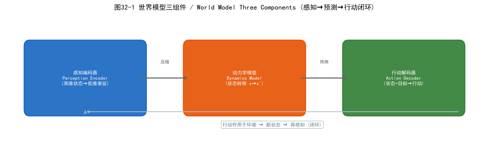
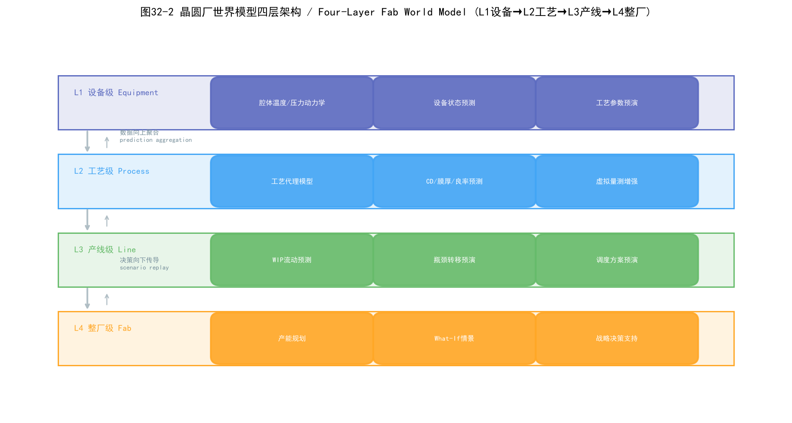
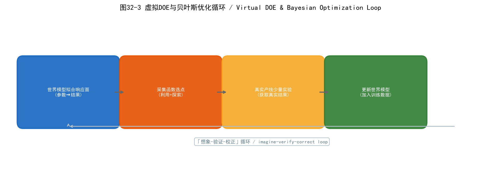
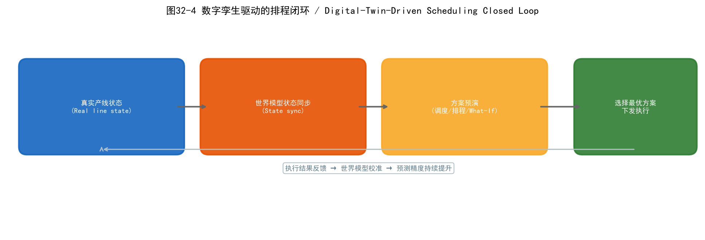
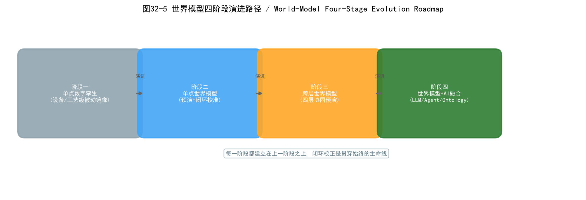

# 第32章 世界模型在晶圓廠的應用——讓AI在「腦中」預演晶圓廠

> 前面幾章討論了 AI 如何感知（連接主義）、如何推理（符號主義）、如何決策（行為主義），以及 LLM/Agent 如何協作、數據體系如何支撐。本章聚焦一個把這些能力「裝進一個可預演環境」的進階主題：**世界模型（World Model）**。

在前面章節中，世界模型已經作為關鍵概念出現：第21章（NSA全融合）把它定義為「能夠模擬環境動態變化的內部模型，使AI能夠在腦中預演行動的後果」，第26章（具身智慧）把它列為智慧體技術棧中的「世界模型層」。本章不再把它當作某個架構的附屬元件，而是正面回答三個問題：**世界模型到底是什麼、晶圓廠的世界模型長什麼樣、它能給晶圓廠帶來什麼價值**。

對晶圓廠而言，世界模型的意義可以用一句話概括：**讓 AI 在「製造之前」先在虛擬世界裡把製造預演一遍**。良率爬坡不必燒掉昂貴的實驗晶圓，排程方案不必先在真實產線上試錯，設備維護不必等到故障發生——世界模型提供了「低代價預演」的能力，這正是第28章數據體系與第29-31章 AI Infra 之上，AI 從「輔助分析」走向「輔助決策」的關鍵一躍。

本章共七節：32.1 釐清數位孿生與世界模型的關係；32.2 給出晶圓廠世界模型的四層架構；32.3 介紹三種關鍵建模技術（物理模擬、數據驅動、混合建模）；32.4-32.6 分別討論世界模型在良率與製程、製造營運、設備與能源三大業務領域的應用；32.7 直面挑戰與展望。

---

## 32.1 從數位孿生到世界模型：晶圓廠AI的「預演能力」

> **本節核心問題**：數位孿生與世界模型是什麼關係？為什麼晶圓廠需要世界模型而不僅僅是數位孿生？

### 32.1.1 數位孿生：已經被廣泛接受的「鏡像」

數位孿生（Digital Twin）在晶圓廠已經不算新概念——第6、7、8章都提到了產線模擬、設備孿生等應用。它的核心思想是：為真實物理系統（一台設備、一條產線、一座工廠）建立一個**與之同步的虛擬鏡像**，虛擬鏡像即時反映物理系統的狀態，並可以在此基礎上進行模擬推演。

晶圓廠數位孿生的典型形態包括：

- **設備級孿生**：為某台蝕刻機建立虛擬模型，即時同步腔體溫度、壓力、RF功率等狀態，用於設備監控與故障診斷
- **製程級孿生**：為某個製程模組（微影、蝕刻、薄膜）建立製程模擬模型，模擬不同參數下的製程結果
- **產線級孿生**：為整條產線建立離散事件模擬（DES, Discrete Event Simulation）模型，模擬 WIP 流動、設備排程與瓶頸形成

數位孿生的價值已被驗證：它提供了「在不觸碰真實產線的前提下進行模擬」的能力。但傳統數位孿生有一個關鍵局限——**它主要是「被動鏡像 + 人工驅動模擬」**：模型由工程師手工建構、按預設場景推演，缺乏自主學習、自我演化的能力。

### 32.1.2 世界模型：從「鏡像」到「會預演的大腦」

世界模型（World Model）是數位孿生的「智慧升級」。兩者的區別可以用一個類比說明：**數位孿生是「地圖」，世界模型是「會自己規劃路線的駕駛員」**。

- **數位孿生回答**：「如果我把參數調到這個值，模擬的結果是什麼？」——需要人先提出問題、設計場景
- **世界模型回答**：「在給定目前狀態下，我應該做什麼，才能讓結果最優？」——模型自己感知狀態、預測未來、評估行動後果

技術上的核心差異在於，世界模型通常包含三個可學習的元件（呼應第21章的表述）：

```
世界模型 = 感知編碼器（將高維狀態壓縮為低維表徵）
         + 動力學模型（預測下一時刻狀態：狀態轉移函數）
         + 行動解碼器（基於狀態預測與目標，輸出行動）
```



*圖32-1:世界模型三元件——感知編碼器+動力學模型+行動解碼器,行動回饋形成閉環*

更關鍵的是，世界模型具備**「在想像中訓練」（imagination-based training）**的能力

：Agent 不只在真實環境（或真實數據）中學習，還可以在世界模型內部「想像」大量未發生的場景進行預訓練——這正是第16章強化學習樣本效率低問題的解藥，也是第21章 NSA 全融合中「在腦中預演」的技術基礎。

### 32.1.3 為什麼晶圓廠特別需要世界模型

晶圓廠有三個特性，使世界模型的價值遠高於一般工業場景：

**試錯成本極高。** 一片12吋晶圓成本超過4000美元，一次製程實驗要燒掉數十片；一次錯誤的設備排程可能導致整批晶圓報廢。任何能在「動手之前先預演」的技術都直接轉化為成本節省。

**系統高度耦合。** 1500多道製程步驟環環相扣，一個參數偏移可能跨模組傳導（蝕刻的負載效應影響後續CMP）。世界模型可以捕捉這種跨模組、跨設備的動態耦合，而傳統單點模擬做不到。

**狀態空間巨大且動態。** 數萬台設備、數十萬個在製批次、每分鐘都在變化的 WIP 分佈——晶圓廠是一個持續演化的動態系統。靜態的數位孿生鏡像難以應對，需要一個能持續學習、隨真實數據自我更新的世界模型。

> **實踐提示:** 不要一上來就追求「整廠級世界模型」。務實的路徑是從**設備級或製程級**起步——一個腔體的溫壓動力學模型、一個製程模組的良率響應模型——先在單點上驗證「預演→最佳化→驗證」閉環的價值，再逐步擴展。整廠級世界模型涉及的狀態耦合與計算成本，遠超單點場景。

> **本節小結:**
> - 數位孿生是「被動鏡像 + 人工驅動模擬」，世界模型是「主動感知 + 預測 + 決策」的可學習模型。
> - 世界模型的三元件公式（感知編碼器 + 動力學模型 + 行動解碼器）與第21章 NSA 全融合一脈相承。
> - 世界模型具備「在想像中訓練」的能力，是緩解強化學習樣本效率低的關鍵。
> - 晶圓廠的高試錯成本、系統強耦合、狀態空間巨大三個特性，使世界模型價值突出，但應從設備/製程級單點起步。

---

## 32.2 晶圓廠世界模型的四層架構

> **本節核心問題**：晶圓廠的世界模型應該建在哪一層？各層之間如何協作？

### 32.2.1 從設備到整廠：四層世界模型

參照數位孿生的分層實踐，晶圓廠世界模型可以劃分為四個層次，每層解決不同粒度的問題：

| 層級 | 建模物件 | 時間尺度 | 典型用途 | 代表技術 |
| --- | --- | --- | --- | --- |
| L1 設備級 | 單個腔體/機台的物理過程 | 毫秒~秒 | 製程參數預演、故障早期預警 | 機理模型、時序預測 |
| L2 製程級 | 一個製程模組（微影/蝕刻/薄膜） | 秒~分鐘 | 製程窗口最佳化、虛擬量測 | 代理模型（Surrogate）、DOE |
| L3 產線級 | 一條產線（多設備多產品） | 分鐘~小時 | WIP 流動預測、排程預演 | 離散事件模擬、圖神經網路 |
| L4 整廠級 | 整座工廠（多產線+資源） | 小時~天 | 產能規劃、What-If 情景 | 系統動力學、多智慧體模擬 |



*圖32-2:晶圓廠世界模型四層架構——數據向上聚合,決策向下傳導*

**架構圖（文字描述）**：自下而上四層。L1 設備級位於底層

，輸入為設備感測器流（FDC 數據），輸出為設備狀態預測與參數預演；L2 製程級在其上，消費多個設備的 L1 輸出與量測數據，輸出製程結果（CD、膜厚、良率）預測；L3 產線級整合所有 L2 製程模組與 MES 數據，輸出 WIP 流動與瓶頸預測；L4 整廠級位於最頂層，綜合 L3 結果與 ERP/產能數據，支援產能規劃與戰略決策。數據向上聚合，決策向下傳導：上層模型基於下層模型的預測做規劃，下層模型回應上層的假設情景進行重放。

### 32.2.2 四層之間的協作模式

四層世界模型不是各自孤立的，它們透過兩種協作模式聯動：

**自底向上的預測聚合。** 設備級模型預測「這台蝕刻機未來1小時的腔體壓力走勢」，製程級模型據此預測「這批晶圓的關鍵尺寸偏差」，產線級模型據此預測「這批晶圓會不會在下游步驟卡住」，整廠級模型據此評估「整體產能是否受影響」。每層把下層的預測作為輸入，逐層放大資訊的業務含義。

**自頂向下的情景重放。** 整廠級模型提出假設：「如果把微影產能提升20%，整廠瓶頸會如何轉移？」 這個假設被分解到產線級（瓶頸設備變化）、製程級（哪些製程步驟成為新瓶頸）、設備級（對應設備的負載變化），各層模型重放假設情景，把影響逐層量化後回饋給上層。

### 32.2.3 世界模型的「數據-模型-閉環」三要素

無論哪一層，一個可用的世界模型都需要三個要素：

**數據。** 世界模型的燃料——FDC 時序、量測結果、MES 事件、設備日誌。數據的品質與覆蓋度直接決定世界模型的精度（呼應第28章數據體系）。

**模型。** 物理機理模型、數據驅動模型或兩者的混合（詳見32.3節）。

**閉環。** 世界模型的預測必須與真實結果對比、校正、更新——「預測→驗證→校正」的閉環是世界模型保持準確性的生命線。沒有閉環的世界模型會隨著產線漂移而逐漸失真。

> **實踐提示:** 判斷一個世界模型是否「活」的標準，不是它的模擬引擎有多複雜，而是它**是否在持續吃進真實數據、持續校正自己的預測**。很多數位孿生專案死於「建完就靜態了」——模型和真實產線漸行漸遠。務必從設計之初就規劃好閉環校正通道。

> **本節小結:**
> - 晶圓廠世界模型分四層：設備級(L1)、製程級(L2)、產線級(L3)、整廠級(L4)，時間尺度從毫秒到天。
> - 四層透過「自底向上的預測聚合」與「自頂向下的情景重放」兩種模式協作。
> - 每層世界模型都包含數據、模型、閉環三要素；沒有閉環校正的世界模型會隨產線漂移失真。

---

## 32.3 三種關鍵建模技術

> **本節核心問題**：晶圓廠世界模型的「動力學模型」用什麼技術實現？三種主流技術路線各有什麼適用場景？

世界模型的「動力學模型」——即預測狀態如何演化的那部分——是技術核心。晶圓廠場景下有三種主流路線，實際專案中常組合使用。

### 32.3.1 物理機理模型（White-box）

基於物理/化學原理建立的狀態演化方程式。例如：

- **腔體熱模型**：根據熱容、熱傳導、加熱功率建立溫度動態方程式，預測溫控響應
- **蝕刻速率模型**：基於 Arrhenius 方程式與電漿參數（壓力、RF功率、氣體比例）預測蝕刻速率
- **CMP 拋光模型**：基於 Preston 方程式（去除率 ∝ 壓力 × 相對速度）預測材料去除量

```python
# 示例: 基於 Preston 方程式的 CMP 去除率預測
def preston_removal_rate(pressure, velocity, k_p=1.2e-3):
    """Preston 方程式: RR = k_p * P * V
    pressure: 拋光壓力 (psi), velocity: 相對速度 (m/s)"""
    return k_p * pressure * velocity
```

**優點**：可解釋性強、外推能力好（參數沒見過的場景也能依據物理規律預測）、數據需求少。**缺點**：建模難度大（真實製程常有多物理場耦合、非線性、未知機理），模型精度受制於對物理機理的理解深度。

### 32.3.2 數據驅動模型（Black-box）

用機器學習從歷史數據中學習狀態演化規律。晶圓廠場景下的典型形態：

- **時序預測模型**：LSTM/Transformer 預測 FDC 參數趨勢（呼應第15章連接主義）
- **代理模型（Surrogate Model）**：用神經網路/高斯過程擬合「製程參數→製程結果」的響應面，替代昂貴的物理模擬
- **圖神經網路產線模型**：把設備、批次、製程步驟建模為圖，GNN 預測 WIP 流動與瓶頸（呼應第12章智慧排程）

```python
# 示例: 用高斯過程作為製程代理模型(製程參數→CD)
from sklearn.gaussian_process import GaussianProcessRegressor
gp = GaussianProcessRegressor()
gp.fit(X_doe, y_cd)          # X_doe: 歷史DOE製程參數, y_cd: 對應CD量測
cd_pred, cd_std = gp.predict(X_new, return_std=True)  # 輸出預測+不確定度
```

**優點**：無需深入理解物理機理、能捕捉數據中的複雜非線性關係、開發週期短。**缺點**：數據飢渴、可解釋性差、外推能力弱（訓練分佈之外的輸入預測不可靠）、對數據品質敏感（呼應第28章：標籤錯誤會讓模型「自信地錯」）。

### 32.3.3 混合建模（Grey-box）：物理約束 + 數據擬合

混合建模結合兩者優勢：**以物理公式為骨架，用數據擬合其中的不確定參數**。這是晶圓廠場景最被推薦的路線。

```python
# 示例: 混合蝕刻速率模型 —— Arrhenius 公式為骨架, 數據擬合活化能
# 物理骨架: RR = A * exp(-Ea/(R*T)) * f(pressure, rf)
# 數據擬合: 用歷史數據擬合 A 和 Ea(通常隨設備狀態漂移)
def hybrid_etch_rate(temp, pressure, rf, A, Ea):
    R = 8.314
    return A * np.exp(-Ea/(R*temp)) * (1 + 0.1*pressure) * (1 + 0.05*rf)
```

**優點**：兼具可解釋性與擬合精度、外推能力優於純數據模型、參數漂移可透過線上校正追蹤（設備老化時重新擬合 A、Ea）。**缺點**：建模仍需物理理解、擬合過程較複雜。

### 32.3.4 三種路線的選擇指南

| 維度 | 物理機理模型 | 數據驅動模型 | 混合模型 |
| --- | --- | --- | --- |
| 可解釋性 | 高 | 低 | 中高 |
| 外推能力 | 好 | 差 | 較好 |
| 數據需求 | 少 | 多 | 中 |
| 建模難度 | 高 | 低 | 中 |
| 線上校正 | 難（參數多） | 易（重訓練） | 易（只校正關鍵參數） |
| 晶圓廠適用場景 | 設備物理過程、機理明確處 | 複雜響應面、數據充足處 | 有物理先驗+參數漂移處(強烈推薦) |

> **實踐提示:** 晶圓廠世界模型的最常見誤區是「迷信純數據驅動」——數據模型在訓練分佈內表現驚豔，一旦設備維護、製程變更導致分佈偏移，預測立刻失真。強烈建議關鍵製程模型採用**混合建模**：用物理公式約束行為邊界，用數據擬合漂移參數，既保外推能力又保校正能力。

> **本節小結:**
> - 三種建模路線：物理機理模型(白箱)、數據驅動模型(黑箱)、混合模型(灰箱)，各有優劣。
> - 物理模型可解釋但建模難，數據模型靈活但外推差，混合模型(物理骨架+數據擬合)在晶圓廠最受推薦。
> - 選擇路線要考慮可解釋性、外推能力、數據需求、線上校正四維度的平衡。

---

## 32.4 世界模型在良率與製程最佳化中的應用

> **本節核心問題**：世界模型如何讓良率分析、製程最佳化從「燒晶圓實驗」走向「虛擬預演」？

### 32.4.1 虛擬良率爬坡：在想像中預演製程開發

第9章討論的良率爬坡之所以昂貴，是因為每片實驗晶圓成本超過4000美元、每次 DOE 實驗都要真刀真槍地在產線上跑。世界模型提供了一條「先預演、後驗證」的路徑：

- **製程級世界模型預演 DOE**：把第32.3節的製程代理模型作為「虛擬實驗台」，在模型中跑完整個 DOE 參數組合（溫度、壓力、氣體流量、RF功率），預測每個組合的 CD、膜厚、良率結果——從中篩選出最有希望的參數區間，再在真實產線上只驗證少量關鍵點
- **良率響應面視覺化**：代理模型輸出「製程參數→良率」的完整響應面，工程師可以直觀看到製程窗口邊界，指導第9章的 PWI（製程窗口指數）最佳化
- **跨模組耦合預演**：製程級世界模型捕捉「蝕刻負載效應→CMP 碟形凹陷→金屬填充不良」這類跨模組傳導，提前發現單點最佳化導致的連鎖問題

**案例**：某晶圓廠用高斯過程代理模型預演蝕刻製程的 DOE，把原先需要120片實驗晶圓的窗口掃描壓縮到16片——世界模型預選出最有資訊量的參數點，實驗只驗證關鍵邊界。DOE 週期從4週縮短到1週，且找到了物理實驗遺漏的一個更優窗口。

### 32.4.2 虛擬量測與製程控制增強

虛擬量測（VM）本質上就是一個「製程級世界模型」：輸入 FDC 感測數據，預測本應量測才能獲得的結果。世界模型框架讓虛擬量測的能力進一步擴展：

- **多步預測**：傳統 VM 預測目前批次的量測值，世界模型可以向前多步預測——「如果這台設備繼續這樣漂移，未來3個批次的膜厚會如何變化」，為預判性調整提供時間窗口
- **不確定性量化**：代理模型（如高斯過程）輸出預測的同時給出信賴區間，工程師可以區分「高信賴預測」（放心免檢）與「低信賴預測」（仍須實測量測）
- **與 R2R 控制聯動**：世界模型的預測可以作為 Run-to-Run 控制的前饋訊號，提前調整下一批次的製程參數，補償設備漂移（呼應第8章 R2R 控制）

### 32.4.3 虛擬 DOE 與貝氏最佳化

第9章提到的貝氏最佳化（Bayesian Optimization）正是世界模型思想的直接應用：用代理模型擬合製程響應面，用採集函數（Acquisition Function）決定下一個實驗點。世界模型框架讓貝氏最佳化更系統化：

```
迭代循環:
1. 世界模型(代理模型)擬合目前已知的 參數→結果 響應面
2. 採集函數在響應面上尋找「最有價值」的下一個實驗點
   (高預測值 → 利用 exploitation; 高不確定性 → 探索 exploration)
3. 在真實產線執行少量實驗, 獲取真實結果
4. 將真實結果加入訓練數據, 更新世界模型 → 回到 1
```



*圖32-3:虛擬DOE與貝氏最佳化的「想像-驗證-校正」循環*

這種「想像-驗證-校正」的循環

，正是世界模型「在想像中訓練」思想在實驗設計中的體現。相比傳統 DOE（預設網格、均勻佈點），虛擬 DOE 用同樣的實驗預算找到更優的參數組合，或同樣找到最優參數但實驗次數減少一個數量級。

> **本節小結:**
> - 製程級世界模型讓良率爬坡從「燒晶圓實驗」走向「先預演後驗證」，DOE 週期可從4週壓縮到1週。
> - 虛擬量測本質上是製程級世界模型，世界模型框架為其增加多步預測與不確定性量化能力。
> - 虛擬 DOE + 貝氏最佳化的「想像-驗證-校正」循環，是世界模型在實驗設計中的直接應用。

---

## 32.5 世界模型在製造營運中的應用

> **本節核心問題**：產線級與整廠級世界模型如何提升排程、調度與產能規劃的品質？

### 32.5.1 WIP 流動與瓶頸預演

第7章討論的製造部（MFG）核心難題是動態調度——WIP 分佈瞬息萬變，瓶頸隨時轉移。產線級世界模型（L3）為此提供了「預演能力」：

- **WIP 流動預測**：以 MES 數據與設備狀態為輸入，世界模型預測未來數小時的 WIP 分佈——哪些工序將積壓、哪些設備將空閒
- **瓶頸轉移預演**：在模型中重放「如果某台設備停機2小時」的情景，預判瓶頸會轉移到哪裡、哪些批次會受影響，提前準備應對
- **排程方案預演**：把候選排程方案（派工規則、優先級設定）輸入世界模型，比較不同方案下的循環時間與瓶頸利用率，選擇最優方案再下發給真實產線

### 32.5.2 動態排程與 What-If 情景

第12章的智慧排程討論了 RL 調度器在模擬環境中訓練後部署到產線——世界模型正是那個「模擬環境」的核心。世界模型讓 RL 調度器可以：

- **在想像中大量試錯**：RL 智慧體在世界模型中與虛擬產線互動數百萬次，學習魯棒的調度策略，而不觸碰真實產線（緩解第16章提到的樣本效率問題）
- **情景評估**：針對「急單插單」「設備故障」「節假日減產」等情景，世界模型重放不同應對策略的後果，輔助管理者決策
- **產能 What-If 模擬**：整廠級世界模型（L4）支援「加設備」「調 OEE」「新品導入」等戰略情景的虛擬推演（呼應第10章產能爬坡），決策前先在虛擬工廠驗證

**案例**：某晶圓廠用產線級離散事件模擬作為 RL 調度器的訓練環境，調度策略在模擬中驗證產出提升約9%（呼應第12章 AISSI 專案結論）後部署到真實產線。世界模型讓 RL 從「不可控的在產線上試錯」變為「先在虛擬產線學夠再上崗」。

### 32.5.3 數位孿生驅動的排程閉環

世界模型不是一次性模擬工具，而是持續進化的閉環系統：

```
真實產線狀態 → 世界模型狀態同步 → 方案預演(調度/排程/What-If)
   ↑                                          ↓
   └── 執行結果回饋 ← 真實產線執行 ← 選擇最優方案下發
```



*圖32-4:數位孿生驅動的排程閉環——狀態同步→方案預演→執行→回饋校正*

每次真實執行的結果都回流到世界模型進行校正

，世界模型的預測精度隨產線數據累積持續提升。這正是第28章「數據-知識-決策」閉環在製造營運中的體現——世界模型是那個讓「決策」可以先在虛擬中驗證、再在現實中執行的載體。

> **本節小結:**
> - 產線級世界模型提供 WIP 流動預測、瓶頸轉移預演與排程方案預演三項能力。
> - 世界模型是 RL 調度器「在想像中訓練」的環境，讓調度策略先在虛擬產線學夠再上崗。
> - 數位孿生驅動的排程閉環：狀態同步→方案預演→執行→回饋校正，世界模型隨數據累積持續進化。

---

## 32.6 世界模型在設備與能源管理中的應用

> **本節核心問題**：設備級與整廠級世界模型如何賦能預測性維護與能源最佳化？

### 32.6.1 設備退化預演與預測性維護

第12章討論了預測性維護的 RUL（剩餘壽命）預測。設備級世界模型（L1）把 RUL 預測升級為「退化過程預演」：

- **退化軌跡預測**：世界模型學習設備的健康特徵退化規律（振動、溫度、壓力、RF功率隨運行時間的演化），不僅能預測「何時失效」，還能預演「從現在到失效的完整退化軌跡」
- **維護影響預演**：在模型中重放「執行 PM 後設備的退化軌跡如何重置」、「跳過 PM 會帶來多大失效風險」，量化維護決策的長期影響
- **部件更換預演**：重放「更換某部件後設備性能恢復到什麼水準」，評估更換時機與性價比

```python
# 示例: 設備退化世界模型 —— 預演不同PM策略下的失效風險
def simulate_degradation(world_model, pm_schedule, horizon_days):
    """在設備世界模型中重放不同PM策略, 統計失效風險"""
    state = world_model.initial_state()
    failure_risk = 0.0
    for day in range(horizon_days):
        if day in pm_schedule:      # 執行PM, 健康狀態重置
            state = world_model.apply_pm(state)
        else:
            state = world_model.step(state)   # 按退化動力學推進
            failure_risk += world_model.failure_probability(state)
    return failure_risk
```

### 32.6.2 能源調度預演

第12章的能源管理討論了錯峰生產。整廠級世界模型（L4）讓能源最佳化從「基於歷史統計」升級為「基於未來預測」：

- **能耗預測**：世界模型預測未來24小時各設備、各工序的能耗曲線（結合生產計畫與設備狀態）
- **錯峰預演**：在模型中重放「把部分批次挪到低電價時段」的方案，評估對循環時間與能耗成本的雙重影響
- **空調系統聯動**：潔淨室空調是能耗大戶，世界模型預測生產負荷與外部溫濕度的耦合，預演空調系統的動態調校策略

### 32.6.3 跨領域協同：世界模型的「全域視野」

世界模型的價值在跨領域協同中進一步放大——同一世界模型可以同時支撐設備、製程、營運、能源四個領域：

- 設備退化預演的結果影響製程級模型的參數漂移預測
- 製程級預測影響產線級 WIP 流動與排程
- 排程方案影響能耗曲線與能源最佳化
- 能源約束反過來約束排程（低電價時段優先）

這種「一個世界模型、多領域共用、跨層協同」的能力，是傳統單點數位孿生無法提供的——也是世界模型作為晶圓廠 AI 基礎設施的核心價值。

> **本節小結:**
> - 設備級世界模型把 RUL 預測升級為「退化軌跡預演」，可量化不同 PM 策略的長期失效風險。
> - 整廠級世界模型讓能源最佳化從歷史統計升級為未來預測，支援錯峰方案預演。
> - 世界模型的跨領域協同——設備/製程/營運/能源共用同一模型——是其作為 AI 基礎設施的核心價值。

---

## 32.7 挑戰與展望

> **本節核心問題**：晶圓廠世界模型的落地面臨哪些現實挑戰？未來如何演進？

### 32.7.1 精度與可信度挑戰

世界模型的價值完全建立在「預測可信」之上——如果模型預演的方案在真實產線上失效，工程師將不再信任它。三個精度相關的挑戰：

- **模型-現實偏差（Sim-to-Real Gap）**：模擬模型與真實產線之間存在不可消除的偏差（未建模的物理效應、近似假設、參數簡化）。必須透過閉環校正持續縮小偏差，而不是一次性建模
- **小機率事件覆蓋**：世界模型對「正常工況」預測很準，但對「設備突發故障」「製程異常」等小機率事件的預測往往失真——而這些恰恰是晶圓廠最需要預演的場景
- **驗證成本**：驗證世界模型的預測需要真實數據/實驗，而真實實驗正是世界模型想省掉的成本——「用昂貴的真實實驗來驗證省錢的模型」存在天然張力

### 32.7.2 數據與計算挑戰

- **數據覆蓋度**：世界模型需要覆蓋產線的全狀態空間，但真實數據往往只覆蓋「正常工況」附近（呼應第28章：異常工況數據稀缺）。需要結合遷移學習、物理先驗來彌補數據盲區
- **即時性**：產線級/整廠級世界模型的預演需要快速回應（分鐘級），而高精度模擬（如 CFD、FEM）計算成本高。需要在精度與速度之間權衡——用代理模型替代昂貴模擬
- **計算基礎設施**：大規模世界模型訓練需要 GPU 叢集，即時推理需要邊緣節點——這正是第29章「AI算力底座」要解決的工程問題

### 32.7.3 與 LLM/Agent/Ontology 的融合前景

世界模型的未來不在孤島，而在於與全書其他技術體系的融合：

- **與 LLM 融合**：LLM 可以作為世界模型的「自然語言介面」——工程師用自然語言提問「如果把微影產能提升20%，良率會怎麼變？」，LLM 把問題翻譯為世界模型的查詢，再把結果翻譯回自然語言報告（呼應第22章 LLM 應用）
- **與 Agent 融合**：多 Agent 系統中的規劃 Agent（第17章 SA融合）可以在世界模型中預演行動後果再執行——「先在世界裡試一遍，再在現實中動手」（呼應第23章 Agent 系統）
- **與 Ontology 融合**：第28章的知識圖譜為世界模型提供「物件-關係」語義骨架，世界模型為知識圖譜提供「動態演化」能力——靜態語義 + 動態模擬互補

### 32.7.4 演進路徑展望



*圖32-5:世界模型四階段演進路徑——從單點數位孿生到世界模型+AI融合*

參照第21章的「四階段演進」，晶圓廠世界模型的建設也可以分階段推進

：

| 階段 | 形態 | 能力 |
| --- | --- | --- |
| 階段一 | 單點數位孿生 | 設備/製程級被動鏡像，人工驅動模擬 |
| 階段二 | 單點世界模型 | 單點預演 + 閉環校正（虛擬 DOE、VM 增強） |
| 階段三 | 跨層世界模型 | 設備/製程/產線/整廠四層協同預演 |
| 階段四 | 世界模型+AI 融合 | LLM/Agent/Ontology 全棧融合的「虛擬晶圓廠」 |

> **實踐提示:** 世界模型專案最容易死在階段一到階段二的跨越——單點數位孿生建好後沒有持續投入閉環校正，模型與真實產線漸行漸遠。務實的建議是：**在階段一就設計好「預測-驗證-校正」的數據回流通道**，讓世界模型從一開始就是「活」的。

---

## 本章小結

世界模型是晶圓廠 AI 從「輔助分析」走向「輔助決策」的關鍵基礎設施——它讓 AI 能夠在「製造之前」先在虛擬世界裡把製造預演一遍。本章沿著「是什麼→怎麼建→哪裡用→什麼挑戰」的邏輯，給出了完整答案：

**是什麼**：世界模型是數位孿生的智慧升級——「數位孿生是地圖，世界模型是會自己規劃路線的駕駛員」。它由感知編碼器、動力學模型、行動解碼器三元件構成，具備「在想像中訓練」的能力，能緩解強化學習樣本效率低的問題。

**怎麼建**：晶圓廠世界模型分四層（設備級 L1、製程級 L2、產線級 L3、整廠級 L4），透過「自底向上的預測聚合」與「自頂向下的情景重放」協作；動力學模型有三條技術路線（物理機理、數據驅動、混合），其中混合建模（物理骨架+數據擬合）在晶圓廠最受推薦；每層都要有「數據-模型-閉環」三要素，閉環校正是生命線。

**哪裡用**：製程級世界模型讓 DOE 從「燒晶圓實驗」走向「先預演後驗證」（週期從4週壓縮到1週）；產線級世界模型為 RL 調度器提供「在想像中訓練」的環境；設備級與整廠級世界模型升級了預測性維護與能源管理；跨領域共用同一世界模型，是其作為 AI 基礎設施的核心價值。

**什麼挑戰**：模型-現實偏差、小機率事件覆蓋、驗證成本是精度挑戰；數據覆蓋度、即時性、計算基礎設施是工程挑戰；未來在於與 LLM、Agent、Ontology 的融合——當世界模型與全書建構的技術體系融合，晶圓廠將擁有一個「可以預演一切決策的虛擬晶圓廠」。

對晶圓廠而言，世界模型的終極願景不是取代任何單一 AI 應用，而是為所有 AI 應用提供一個**可以低成本試錯的「預演環境」**——良率分析先在虛擬製程上驗證、調度決策先在虛擬產線上推演、維護策略先在虛擬設備上評估。當這個預演環境足夠可信、足夠即時、足夠智慧，晶圓廠的 AI 才真正從「看懂過去」走向「預演未來」。
